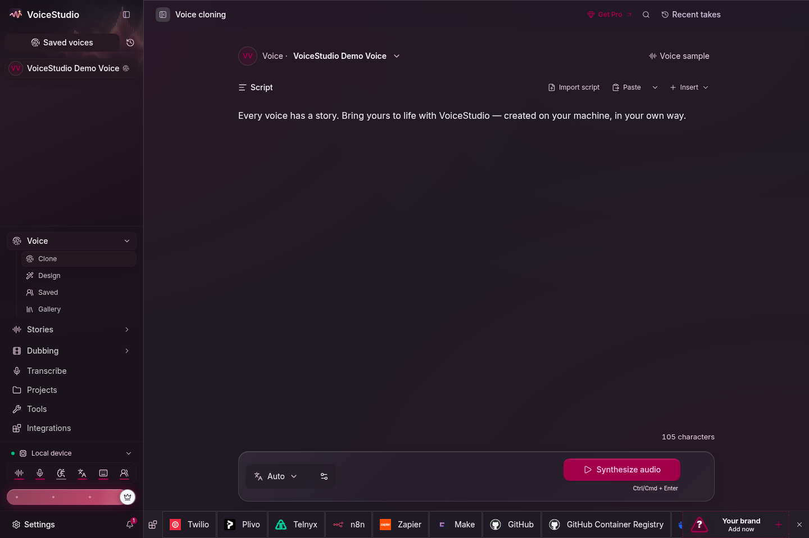
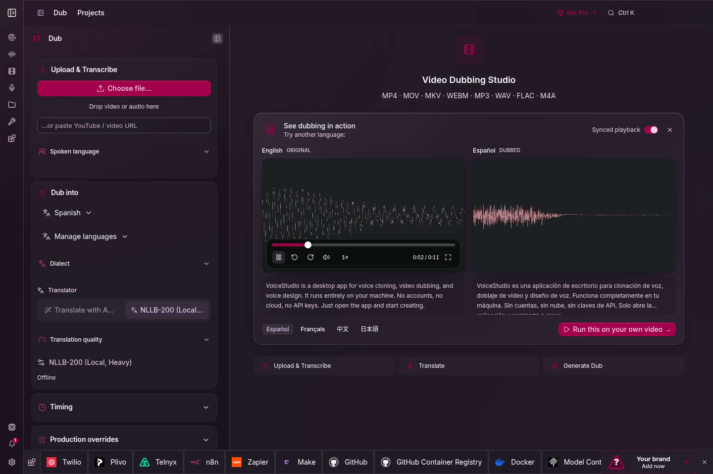
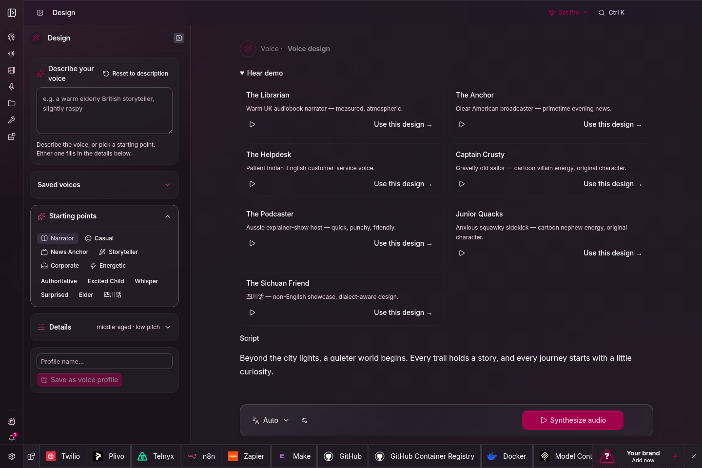

<div align="center">
  
  <h1>VoiceStudio</h1>
  <p>
    <a href="https://trendshift.io/repositories/28176?utm_source=repository-badge&amp;utm_medium=badge&amp;utm_campaign=badge-repository-28176" target="_blank" rel="noopener noreferrer"></a>
  </p>
  <p><strong>Open-source voice cloning, voice design, video dubbing, dictation, transcription & audiobook creation in 646 languages.</strong></p>
  <p>
    <a href="https://voicestudio.sh/?utm_source=github&utm_medium=readme&utm_campaign=project">Website</a> ·
    <a href="https://github.com/debpalash/VoiceStudio/releases/latest">Download</a> ·
    <a href="#get-started">Get started</a> ·
    <a href="#documentation">Docs</a> ·
    <a href="https://discord.gg/bzQavDfVV9">Discord</a> ·
    <a href="docs/readme/README_CN.md">简体中文</a> ·
    <a href="docs/readme/README_JA.md">日本語</a>
  </p>
  <p>
    <a href="https://github.com/debpalash/VoiceStudio/actions/workflows/ci.yml"></a>
    <a href="https://github.com/debpalash/VoiceStudio/releases/latest"></a>
    <a href="LICENSE"></a>
    <a href="https://supermetry.com"></a>
  </p>
</div>


## Your voice. Your workflow.

| Create | Produce | Connect |
| :--- | :--- | :--- |
| Clone a voice or design your own | Dub videos with timed speech | Local API & MCP for agents |
| Dictate with a floating widget | Stories, audiobooks & batch jobs | Reusable recipes & watch folders |

Start with **VoiceStudio** (default, powered by k2-fsa/OmniVoice), or choose another engine. [Features & engine catalog](docs/feature-catalog.md).

Local workflows run on your hardware. Remote services are optional; usage analytics requires consent.

## ChiefTechnicalWizard Fork Enhancements & Architectural Rationale

This fork tracks upstream `debpalash/VoiceStudio` (`v0.5.7-beta.2`) and adds hardware-level optimizations for **NVIDIA Blackwell (`sm_120` / `sm_121`)** GPUs, zero-overhead audio I/O under **PyTorch 2.12–2.15+cu130**, external **CrisperWhisper 2.0 Large** HTTP ASR integration, and our **Pipeline v3 Pure-Story Audiobook Engine** (`scripts/pipeline_v3/`).

| Enhancement | Files Modified / Added | Engineering Reason & Impact |
| :--- | :--- | :--- |
| **1. Blackwell `torch.compile` Mode Override (`OMNIVOICE_TORCH_COMPILE_MODE`)** | `backend/services/model_manager.py` | **Why:** Upstream defaults `_TORCH_COMPILE_MODE` to `"reduce-overhead"` on `sm_80+` GPUs, which records per-shape CUDA Graphs and forces single-thread execution via `_install_compile_thread_affinity`. During long-form audiobook synthesis with variable-length thoughts (`35–280` chars), CUDA Graph shape-bucketing triggers repeated graph captures and blocks multi-worker GPU concurrency. Setting `OMNIVOICE_TORCH_COMPILE_MODE=default` compiles Triton/Inductor kernels on Blackwell (`sm_120` RTX 5070 Ti / `sm_121` Grace Blackwell GB10) without CUDA Graph overhead while preserving multi-worker throughput (`~1.17s–1.21s` per 24-step sentence). |
| **2. Direct `soundfile` Audio Loading Fast-Path** | `omnivoice/utils/audio.py` | **Why:** In `torchaudio >= 2.9` (including PyTorch `2.12+cu130` and `2.15+cu130`), `torchaudio.load(..., backend="soundfile")` ignores the `backend` parameter and routes through `TorchCodec`, raising `ImportError` when FFmpeg shared libraries are absent and falling back to spawning a `pydub`/`ffmpeg` subprocess on every voice reference load. Reading directly via `soundfile.read(audio_path, dtype="float32")` first eliminates subprocess overhead and `TorchCodec` failures while keeping `torchaudio` and `pydub` as fallbacks. |
| **3. CrisperWhisper 2.0 Large HTTP ASR Backend (`crisper-whisper`)** | `backend/services/asr_backend.py`, `scripts/crisperwhisper_server.py`, `docs/engines/crisperwhisper-asr.md`, `tests/test_crisperwhisper_backend.py` | **Why:** High-throughput audiobook QA and voice-reference transcription benefit from a dedicated, resident **CrisperWhisper 2.0 Large** microservice (`OMNIVOICE_CRISPERWHISPER_URL`, default `http://127.0.0.1:8090/transcribe`). Includes both the `CrisperWhisperBackend` client adapter (auto-detected #1 priority when reachable, `<1.2s` per clip) and the standalone FastAPI server (`scripts/crisperwhisper_server.py`) supporting `verbatim` disfluency detection and `intended` transcription. |
| **4. Pipeline v3 Pure-Story Long-Form Audiobook Engine** | `scripts/pipeline_v3/normalizer.py`, `epub_parser.py`, `pure_story_checker.py`, `dsp.py`, `qa_gate.py`, `auk_repair.py`, `async_engine.py`, `packager.py` | **Why:** Long-form book narration requires strict narrative hygiene and acoustic consistency across thousands of sentences:<br>• **Pure Story OPF Spine Extraction (`epub_parser.py`, `pure_story_checker.py`)**: Traverses true EPUB `<itemref>` spine order, heals Calibre drop-caps, and strips 100% of non-story frontmatter/backmatter (`tests/test_pure_story_integrity.py`).<br>• **Quote-Aware Complete-Thought Chunking & Phonetic Normalizer (`normalizer.py`)**: Segments prose into complete thoughts (`<= 280` chars, median `~142` chars / `25` words), heals mid-sentence quote splits, and expands numbers, ordinals, abbreviations, and Roman numerals prior to synthesis (`tests/test_dropcap_and_phonetics.py`).<br>• **Contextual Paralinguistic Director (`inject_contextual_paralinguistics`)**: Enriches attributed dialogue and contemplative prose with native OmniVoice v0.5.7+ inline markers (`[sigh]`, `[laughter]`, `[pause 350ms]`, and `instruct="whisper"`) on initial pass while stripping non-verbal markers in `normalize_qa_tokens()` so CrisperWhisper QA scores spoken words fairly.<br>• **Pitch-Floor & Vocal-Tract Timbre Gate (`auk_repair.py`, `qa_gate.py`)**: Combines CrisperWhisper token-level QA scoring + verbatim stutter rejection with `librosa.yin` F0 pitch-floor checks (`med_F0 >= 109–112 Hz`, `p25_F0 >= 102–104.5 Hz`), voiced spectral centroid checks (`>= 720–750 Hz`), and energy-invariant `mfcc[1:]` cosine similarity to prevent low-register pitch drops on short dialogue quotes.<br>• **Broadcast DSP & EBU R128 Mastering (`dsp.py`, `packager.py`)**: Applies 5ms raised-cosine micro-fades, dynamic inter-thought (`450ms`) and paragraph (`750ms`) breath pacing, and two-pass `ffmpeg loudnorm` mastering (`-18 LUFS`, `-1.5 dBTP`). |
| **5. AuK 1.5B Surgical Speech Healing & Broadcast Soundscape Docs** | `docs/engines/auk-speech-healing.md`, `docs/broadcast-soundscape-system.md` | **Why:** Documents how resident **Tencent-Hunyuan AuK 1.5B** (`:3950`) performs in-place word/phoneme replacement and stutter removal without full-chapter re-synthesis, alongside multi-stream broadcast soundscape architecture. |

### Recommended Blackwell (`sm_120` / `sm_121`) Environment Configuration

```bash
export PYTORCH_CUDA_ALLOC_CONF="expandable_segments:True"
export NVIDIA_TF32_OVERRIDE="1"
export OMNIVOICE_DEVICE="cuda"
export OMNIVOICE_TORCH_COMPILE_MODE="default"
export OMNIVOICE_PROMPT_DISK_CACHE="1"
export OMNIVOICE_GPU_WORKERS="4"          # 4 on 128 GB GB10 (sm_121), 2 on 16 GB RTX 5070 Ti (sm_120)
export OMNIVOICE_IDLE_TIMEOUT_S="86400"
export OMNIVOICE_ASR_BACKEND="crisper-whisper"
export OMNIVOICE_CRISPERWHISPER_URL="http://127.0.0.1:8090/transcribe"
```

<details>
<summary><strong>Explore the workspaces</strong> · Clone, dub, design & models</summary>

<table>
  <tr>
    <td></td>
    <td></td>
  </tr>
  <tr><td align="center">Voice cloning</td><td align="center">Video dubbing</td></tr>
  <tr>
    <td></td>
    <td></td>
  </tr>
  <tr><td align="center">Voice design</td><td align="center">Local models</td></tr>
</table>


</details>

## Get started

### One-command install (macOS / Linux)

```sh
# Latest Electron release
curl -fsSL https://voicestudio.sh/install | sh

# A specific published Electron release (replace X.Y.Z)
curl -fsSL https://voicestudio.sh/install | sh -s -- --version X.Y.Z

# Build current main and install the desktop app
curl -fsSL https://voicestudio.sh/install | sh -s -- --main

# Uninstall the app, keeping your data
curl -fsSL https://voicestudio.sh/install | sh -s -- --uninstall
```

On Windows, run `irm https://voicestudio.sh/install | iex` in PowerShell.

If `voicestudio.sh/install` is unreachable or returns 404, run the same script
straight from the repository, or clone it and run `scripts/install.sh`:

```bash
curl -fsSL https://raw.githubusercontent.com/debpalash/VoiceStudio/main/scripts/install.sh | sh
```

Release downloads require curl and a SHA-256 tool. `--main` requires Git,
Node.js 22+, Bun, Rust/Cargo, and platform build tools; see
[installer prerequisites and behavior](docs/install/script.md).
The installer preserves your settings, projects, and models. Older versions
must contain Electron packages; it never falls back to archived Tauri builds.

Or download from [Releases](https://github.com/debpalash/VoiceStudio/releases/latest) (macOS `.dmg`, Windows `.exe`, Linux `.AppImage` or `.deb`) and follow your platform guide:

**[macOS](docs/install/macos.md) · [Windows](docs/install/windows.md) · [Linux](docs/install/linux.md) · [Docker](docs/install/docker.md)**

| Hardware | Support |
|---|---|
| NVIDIA GPU (Windows / Linux) | CUDA acceleration |
| Apple Silicon | Metal (MPS) acceleration |
| No dedicated GPU (Intel/AMD integrated graphics, older PCs) | Fully usable on the CPU, slower; setup installs the small CPU build of PyTorch (about 5 GB free disk) |
| Windows on ARM (Snapdragon X etc.) | **Experimental**, validation pending: native ARM64 app, x64 Python backend under emulation, CPU only |
| Intel Mac | App UI only; connect to a remote backend ([why](docs/install/macos.md)) |

Open **Voice cloning**, choose a voice or add a clean reference recording, enter your text, and generate. Install the required model when prompted. Hardware needs vary by engine; see [performance](docs/performance.md).

### Install with prompt

Paste into your coding agent (Claude Code, Codex, Cursor, …):

```text
Install the VoiceStudio Electron app on this device and verify it works, following
https://github.com/debpalash/VoiceStudio/blob/main/docs/install/agent.md
```

The [agent guide](docs/install/agent.md) covers hardware detection, reusing existing
data, asking before model downloads, and a test generation. Agents that support skills
can also run `npx skills add debpalash/VoiceStudio`.

<details>
<summary><strong>Run the Electron preview from source</strong></summary>

```bash
git clone https://github.com/debpalash/VoiceStudio.git
cd VoiceStudio
bun install
bun run setup:api  # prepare Python dependencies before starting Electron
bun run dev
```

See [Electron setup](electron/README.md) for prerequisites and backend configuration.

Use `bun run smoke-test` to build and launch an isolated packaged Electron app.
Add `-- --install` for the networked managed-runtime installation check.

</details>

> **Electron is the only desktop app and web UI.** Version 0.5.3 was the final Tauri release. Existing Tauri users must [install Electron separately](docs/electron-migration.md). The retired Tauri shell and legacy UI entry points have been removed.

## Documentation

| Need | Start here |
|---|---|
| Setup help | [Troubleshooting](docs/install/troubleshooting.md) · [Model downloads](docs/downloading-models.md) |
| Models & audio quality | [Engine guides](docs/engines/README.md) · [Benchmarks](docs/benchmarks.md) |
| Integrations | [Local API](docs/speech-platform.md) · [MCP](docs/mcp.md) · [Examples](examples/README.md) |
| Phone apps (preview, run offline) | [iOS and Android](docs/mobile.md) |
| Development | [Contributing](.github/CONTRIBUTING.md) ([CLA signing guidance](.github/CONTRIBUTING.md#contribution-licensing) for your first PR) · [Electron](electron/README.md) · [Changelog](CHANGELOG.md) |

Agent skills: `npx skills add debpalash/VoiceStudio` — choose **voicestudio** for audio workflows or **voicestudio-maintainer** for repository maintenance.

## Sponsors

Sponsorship funds maintainer time, development tools, release infrastructure and test hardware; it buys recognition, not features.

[GitHub Sponsors](https://github.com/sponsors/debpalash) · [Ko-fi](https://ko-fi.com/debpalash) · [PayPal](https://paypal.me/palashCoder) · [Tiers and recognition](SPONSORS.md) · [Ask for recognition](https://github.com/debpalash/VoiceStudio/issues/new?template=sponsor.yml)

## License & responsible use

[AGPL-3.0](LICENSE) covers the application, including commercial use under its conditions. Model weights, tokenizers, voices and generated-output conditions are separate; a paid app licence does not grant those rights. Clone voices only with permission. Model Manager now shows versioned model-source notices, evidence links and unresolved review gaps from the [shared inventory](docs/licensing/model-inventory.md). Its optional [reviewed-file preview](docs/licensing/model-review-workflow.md) does not enforce ordinary downloads or certify commercial permission. See [license details](LICENSE-NOTICE.md).

