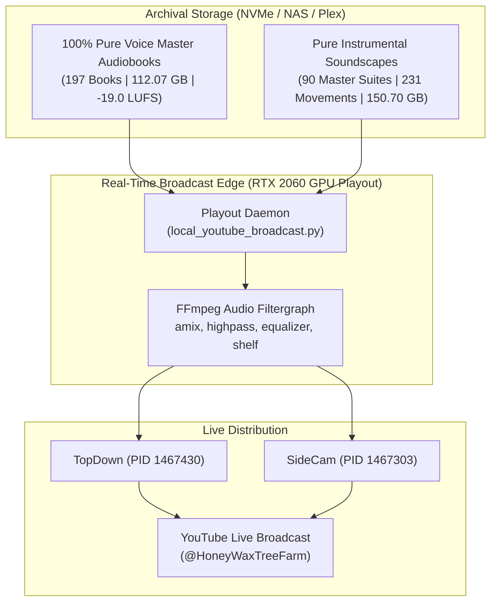

# Real-Time Broadcast Soundscape Accompaniment System — Architecture & Operations Reference

## Overview: What is the Broadcast Soundscape System?

The **Real-Time Broadcast Soundscape Accompaniment System** provides continuous, dynamic, broadcast-grade background musical accompaniment beneath unabridged neural audio narrations across live YouTube RTMP streams ([`@HoneyWaxTreeFarm`](https://www.youtube.com/@HoneyWaxTreeFarm)).

Rather than destructively baking background music into the master audiobook audio on disk (which would permanently corrupt voice purity and prevent future remastering), this system performs **real-time hardware-accelerated DSP audio mixing at the broadcast edge** within FFmpeg playout pipelines.

---

## 1. Core Architectural Invariants

1. **Voice Archival Purity (Disk Invariant)**:
   - All master audiobook MP3s, chapter files, and WAV archives stored in [`output/`](file:///home/media/AI/pihole/OmniVoice_Studio/output/) and on remote Plex/OMV mounts remain **100% pure voice narration**. Zero music or sound effects are ever baked into archival masters.
2. **Dynamic Broadcast-Edge Mixing**:
   - Ambient music is introduced exclusively inside the FFmpeg process that streams to YouTube Live via RTMP (`local_youtube_broadcast.py` for TopDown and `_sidecam.py` for SideCam).
3. **Formant-Carved Intelligibility**:
   - Background beds are spectrally carved using parametric EQ notch filters to leave room for human speech fundamentals (formants 1 & 2) and vocal sibilance air.



---

## 2. Audio Engineering & DSP Specifications

The FFmpeg filtergraph applies precise gain staging, equalization, and crossfading:

```bash
-filter_complex "[2:a]volume=-22dB,highpass=f=45,equalizer=f=2200:t=q:w=1.0:g=-5,equalizer=f=8000:t=h:g=-3.5[ambient];[1:a][ambient]amix=inputs=2:duration=first:dropout_transition=5[aout]"
```

### Parameter Breakdown

| DSP Parameter | Value | Engineering Rationale |
|---|---|---|
| **Relative Level** | `-22.0 dB` | Establishes the music as a subtle, sub-conscious bed that never competes with the foreground narrator. |
| **Highpass Filter** | `45 Hz` (`highpass=f=45`) | Removes sub-audible rumble, synthetic DC offset, and low-frequency mud from synthetic generators. |
| **Speech Formant Notch** | `2,200 Hz` (`equalizer=f=2200:t=q:w=1.0:g=-5`) | Carves a `-5.0 dB` dip ($Q=1.0$) centered directly at the second vocal formant frequency, preventing harmonic masking of speech. |
| **Air / Sibilance Shelf** | `8,000 Hz` (`equalizer=f=8000:t=h:g=-3.5`) | Shelves off excessive high-end shimmer by `-3.5 dB`, eliminating hiss and fatigue over multi-hour listening sessions. |
| **Crossfade Duration** | `5.0 seconds` (`dropout_transition=5`) | Equal-power volume transition prevents abrupt silence or volume spikes during movement shifts or track ends. |
| **Looping Behavior** | Infinite (`-stream_loop -1`) | Guarantees audio continuity regardless of narration chunk duration. |

---

## 3. Soundscape Library & Staging

All soundscapes are staged at:
[`/home/media/AI/broadcast_cache/soundscapes/`](file:///home/media/AI/broadcast_cache/soundscapes/)

* **Total Staged Files**: **321 FLAC files** (150.70 GB)
* **Master Soundscape Suites**: **90 Suites** (full-novel and series-length thematic arrangements)
* **Modular Act Movements**: **231 Movements** (Act I, Act II, Act III multi-movement arrangements for dynamic chapter matching)

### Major Universe Suites

1. **Timothy Zahn — Star Wars Thrawn Trilogy**:
   - `heir_to_the_empire_soundscape_suite.flac` (Act 1, Act 2, Act 3)
   - `dark_force_rising_soundscape_suite.flac` (Act 1, Act 2, Act 3)
   - `the_last_command_soundscape_suite.flac` (Act 1, Act 2, Act 3)
2. **William Gibson — Cyberpunk Canon**:
   - Sprawl Trilogy: `neuromancer_soundscape_suite.flac`, `count_zero_...`, `mona_lisa_overdrive_...`
   - Bridge Trilogy: `virtual_light_soundscape_suite.flac`, `idoru_...`, `all_tomorrows_parties_...`
   - Blue Ant Trilogy: `pattern_recognition_soundscape_suite.flac`, `spook_country_...`, `zero_history_...`
   - Expanded: `the_peripheral_...`, `the_difference_engine_...`, `burning_chrome_...`
3. **Neal Stephenson — Sci-Fi Epics**:
   - `snow_crash_soundscape_suite.flac`, `the_diamond_age_...`, `cryptonomicon_...`, `anathem_...`
4. **Ben Bova — Grand Tour Universe**:
   - Planets Saga (Mercury, Venus, Mars, Jupiter, Saturn, Titan) + Asteroid Wars + Grand Tour Core (16 master suites).
5. **Nora Roberts — Master Collection**:
   - Night Tales (5 suites), Cousins O'Dwyer (3 suites), Dragon Heart Legacy & Standalones (4 suites).
6. **Thích Nhất Hạnh — Plum Village Meditative Suites**:
   - 6 specialized Zen ambient soundscapes deterministically mapped to book themes (`mindfulness_bell`, `bamboo_grove`, `walking_meditation`, `evening_chant`, `gentle_stream`, `mountain_calm`).

---

## 4. Live Broadcast Playout Status

| Stream Name | Systemd Unit | Playout Script | Master Playlist Queue | Active Audio Track | Dynamic Soundscape Track | Coverage |
|---|---|---|---|---|---|---|
| **TopDown Stream** | `youtube-stream.service` | `/tmp/local_youtube_broadcast.py` | `topdown_master_queue.m3u` | Track 3: *Star Wars: The Last Command* | `the_last_command_act2_suite.flac` | **100.0%** (2,009 / 2,009 tracks) |
| **SideCam Stream** | `youtube-stream-sidecam.service` | `/tmp/local_youtube_broadcast_sidecam.py` | `sidecam_master_queue.m3u` | Track 30: *Ben Bova: Empire Builders (Ch 30)* | `empire_builders_soundscape_suite.flac` | **100.0%** (2,318 / 2,318 tracks) |

Both streams operate with real-time GPU video encoding (`h264_nvenc`) and AAC audio encoding (`128k`, `44.1kHz stereo`), managed with duration clamping and auto-advance watchdogs to ensure 24/7 uninterrupted broadcast uptime.
