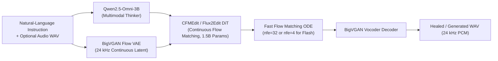

# AuK (Audio Universal Kernel) — Architecture & Capabilities Reference

## Overview: What is AuK?

**AuK (Audio Universal Kernel)**, developed by Tencent-Hunyuan (released September 2026), is a **1.5-Billion parameter multimodal foundational model** for speech generation, acoustic manipulation, and audio surgery.

Unlike conventional Text-to-Speech (TTS) engines (e.g., ElevenLabs, ChatTTS, CosyVoice, F5-TTS) that can only synthesize new audio from scratch, AuK unifies **generation, content editing, acoustic directing, and audio restoration** under a single natural-language ChatML interface. You provide an instruction in plain English (or Chinese) alongside an optional audio clip, and it performs the requested acoustic operation.

Resident deployment on NVIDIA Blackwell GB10 GPU (`127.0.0.1:3950`).

---

## 1. Core Capabilities Breakdown

AuK's capabilities fall into five primary categories:

```mermaid
flowchart TD
    Kernel["AuK (Audio Universal Kernel — 1.5B DiT)"]
    
    Kernel --> Gen["Generation"]
    Kernel --> Surg["Content Surgery"]
    Kernel --> Para["Paralinguistics"]
    Kernel --> Direct["Acoustic Directing"]
    Kernel --> Rest["Restore & Separate"]
    
    Gen --> G1["Zero-Shot Voice Cloning"]
    Gen --> G2["Instruct TTS (Persona Prompting)"]
    
    Surg --> S1["Replace Word / Phoneme"]
    Surg --> S2["Insert Text in Waveform"]
    Surg --> S3["Delete / Purge Stutters"]
    Surg --> S4["Singing Lyric Editing"]
    
    Para --> P1["Emotion Shift (Fear, Joy, Anger)"]
    Para --> P2["Whisper / Stage Speech"]
    Para --> P3["De-accenting / Dialect Smoothing"]
    Para --> P4["Nonverbal Ingestion (Breath, Chuckle)"]
    
    Direct --> D1["Pitch Shift (± semitones)"]
    Direct --> D2["Speed Scaling (0.5x – 2.0x)"]
    Direct --> D3["Gain & Level Matching (± dB)"]
    
    Rest --> R1["Denoise & Dereverberation"]
    Rest --> R2["Multi-Speaker Separation"]
    Rest --> R3["Semantic Target Voice Extraction"]
```

### A. In-Place Speech Content Surgery (Its Standout Superpower)

This is AuK's primary technical breakthrough. In conventional workflows, if a narrator stumbles on a single word in a 15-second sentence, the entire sentence must be re-recorded or re-synthesized. AuK edits the waveform in-place:

* **Replacement**: *"Replace 'Coruscant' with 'Core-oo-sahnt'."* (Preserves the speaker's breath, cadence, room resonance, and surrounding words).
* **Insertion**: *"Add 'not' before 'guilty'."* or *"Add 'Super' after 'on'."*
* **Deletion**: *"Remove 'um, well,'."* (Cleans stutters, false starts, and repeated words).
* **Singing Lyric Editing**: Replaces words in a sung vocal track while preserving melody, key, and pitch vibrato.

### B. Instruct TTS & Persona Directing (No Reference Audio Required)

Instead of providing a cloned reference sample, a voice can be directed entirely with natural-language stage directions:
* **Example**: *"Say in the voice of an elderly, world-weary sea captain, speaking slowly with deep gravelly chest resonance: 'The tide doesn't wait for any man.'"*
* AuK's multimodal thinker model (Qwen2.5-Omni-3B) interprets tone, age, accent, pace, and dramatic subtext directly from the prompt.

### C. Zero-Shot Voice Cloning

* Clones any target speaker from as little as 3 to 5 seconds of clean reference audio: *"Say the following with the same voice: '{text}'"*.

### D. Paralinguistic & Expressive Modification

* **Emotion Shifting**: Transforms the emotional delivery of existing speech (*"Say this in a trembling, fearful voice"* or *"Say this with suppressed amusement"*).
* **Whisper Conversion**: Converts normal speech into an intimate or conspiratorial whisper while keeping speaker identity intact.
* **De-accenting / Dialect Smoothing**: Removes heavy regional accents while maintaining the speaker's vocal timbre.
* **Nonverbal Sound Editing**: Surgically injects or removes realistic human acoustic phenomena:
  * *"Add a breath before 'I can't do this'"*
  * *"Remove the heavy gasp at the end"*
  * *"Add a chuckle after 'of course'"*

### E. Acoustic Post-Production & Mastering

* **Pitch Shift**: Raise or lower the pitch by $N$ semitones (*"Raise the pitch by 2 semitones"*).
* **Speed Scaling**: Adjust the speaking rate (0.5x to 2.0x) without altering pitch.
* **Level Matching**: Reduce or increase volume (*"Reduce volume by 6 decibels"*).

### F. Speech Enhancement & Source Separation

* **Denoising & Dereverberation**: Removes ambient noise, background hum, and room reverberation.
* **Multi-Speaker Diarization / Separation**: Isolates individual speakers in an overlapping conversation based on talking order.
* **Semantic Target Speaker Extraction**: Isolates a specific speaker out of crowded chatter based on what they said (*"Keep the speaker who says 'I agree with the budget proposal'"*).

---

## 2. What is AuK Best Used For? (Real-World Use Cases)

| Use Case | How AuK Solves It | Conventional Alternative |
| :--- | :--- | :--- |
| **Audiobook QC & Error-Healing** | When CrisperWhisper QA catches a dropped word or mispronounced name, AuK heals the 1–2 words in ~3 seconds without re-recording the paragraph. | Full chunk re-synthesis (slow, causes prosody and acoustic room mismatch with neighboring audio). |
| **Character Voice Acting for Games/Audio Drama** | Directs nuanced emotions (whispering, sobbing, theatrical villainy, breathy pauses) using descriptive text prompts. | Hiring multiple voice actors or running multiple disparate style-transfer models. |
| **Podcast & Dialogue Post-Production** | Purges vocal fry, stray coughs, filler words (*"uh"*, *"like"*), or tunes pacing in post. | Tedious manual spectral editing in iZotope RX or DAW automation. |
| **Dubbing & Localization** | Replaces translated terms or brand names in existing takes without desyncing overall duration or lip flap timing. | Re-booking voice talent for pickup sessions. |
| **Meeting / Surveillance Forensic Extraction** | Pulls one specific speaker out of overlapping conference chatter based on context. | Frequency filtering or blind source separation (BSS). |

---

## 3. How It Works Under the Hood

1. **Multimodal Instruction Understanding**: Powered by **Qwen2.5-Omni-3B**, which parses both the semantic instruction and the conditioning audio stream.
2. **Continuous Latent Representation**: Uses **BigVGANFlowVAE** operating at 24 kHz (downsampled by 2400x to a 64-dimensional continuous latent space), preserving rich acoustic micro-details that discrete tokenizers (like EnCodec or SNAC) often discard.
3. **Continuous Flow Matching (CFM) Backbone**: Powered by **Flux2Edit**, an ODE-based Diffusion Transformer (DiT) that models audio transformations as continuous probability trajectories, yielding artifact-free edits and smooth transitions between original and healed audio.
4. **Vocoder Reconstruction**: Decoded via the native **BigVGAN Vocoder** into 24 kHz uncompressed PCM audio.

---

## 4. Strengths & Key Trade-Offs

### Strengths:
* **Zero Splicing Artifacts**: Edits sound acoustically continuous because the diffusion model solves the boundary conditions continuously in latent space.
* **Unified Interface**: One model replaces 5 separate specialized tools (TTS engine, denoiser, pitch shifter, vocal isolator, and manual audio editor).
* **Speed on Blackwell**: Running resident on NVIDIA Blackwell GB10 (`:3950`), a typical 3–5 second audio surgery executes in **~3.2 seconds** over HTTP.

### Trade-Offs & Limitations:
* **Chunk-Based (Not Long-Form)**: Designed for thought chunks and phrases up to 30 seconds. For 1-hour files, audio must be split into thought units or sentences before processing.
* **Model Footprint**: The full base pipeline requires ~10–18 GB of memory. (On a 128 GB Unified Memory GB10 host, this leaves ~110 GB free headroom).
* **Native 24 kHz Output**: 24 kHz is standard for BigVGAN neural speech; when outputting to 44.1 kHz or 48 kHz broadcast pipelines, it passes through standard resamplers or linear interpolation.
